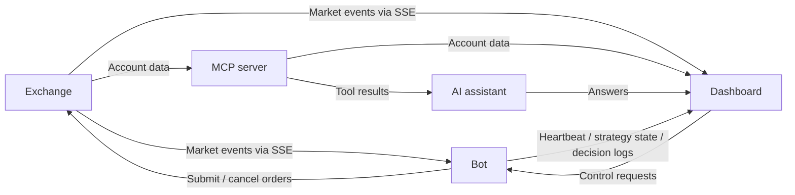

# System architecture

Based on the pre-read, the hackathon is about repairing and improving the supplied trading system: the bot, dashboard and their integrations. The final scope and judging criteria arrive with the team package.

The exchange runs the market. The bot trades. The dashboard displays information and sends control requests. The supplied MCP server provides account data.

## Components

| Component | Responsibility | Baseline status |
|---|---|---|
| Exchange | Market events, orders, positions and P&L | Supplied platform |
| Python bot | Strategy signals, risk checks and order execution | Working baseline with bugs |
| Dashboard | Market/account views and human controls | Partial implementation |
| MCP server | Read tools for portfolio, positions, P&L and session summary | Working; run it yourself |
| AI assistant | Answer questions using tools and cited data | Panel not implemented |

## Connections

Arrows show information flow. Bot-state and control channels still need building; their transport is not specified.

## Strategies and current support

Status comes from the pre-read handover; verify it against the baseline code at registration.

| Strategy or capability | Instrument | How it works | Current support |
|---|---|---|---|
| Momentum | NOVA | Compare latest price with the oldest in a lookback window; buy above a positive change threshold, sell below the negative threshold. | Connected and trading. Suits sustained moves; quiet markets can produce poor signals. |
| Mean reversion | ELXR | Compare price with its rolling average; buy sufficiently below it, sell sufficiently above it. | Connected and trading, but the lookback must change from 5 to 15 samples. |
| Market-making | ELXR / AXON candidates | Post buy and sell quotes while adjusting them for inventory. | Disabled skeleton exists; inventory skew needs fixing before use. |
| NOVA → AXON lead/follow signal | AXON, using NOVA | A new NOVA high can trigger an AXON buy proposal, subject to risk checks. | Suggested in the notes; not implemented according to the handover. |
| Momentum on another instrument | CRVX | Reuse momentum with CRVX-specific parameters. | Additional instrument configuration is unfinished; this is not a new strategy type. |
| Market-condition detection | Per instrument | Use the supplied ATR percentage to allow/suppress momentum, switch behaviour or reduce size. | Not implemented. This routes or adjusts strategies; it is not a standalone buy/sell strategy. |

DRFT has no implemented strategy identified in the handover. Trading it is optional, with small sizing and an explicit market-impact rationale.

## Intended bot flow

| Step | What happens |
|---|---|
| **1. Discover instruments** | Fetch the available instruments and load each one's configuration. |
| **2. Receive prices** | SSE supplies new events; keep recent price samples separately per instrument. |
| **3. Detect market conditions** | Estimate volatility and choose an appropriate trading posture. Volatility alone does not indicate price direction. |
| **4. Select a strategy and generate a signal** | The selected strategy proposes buy, sell or no action using its own parameters. A signal is not a completed trade. |
| **5. Apply risk checks** | Pause/kill state, position limits, order size and available request budget can block or reduce the proposal. |
| **6. Submit a limit order** | Send an order with a price limit. Acceptance does not guarantee an immediate or complete fill. |
| **7. Track execution and report** | Track fills and remaining quantity; the dashboard reads account state through MCP and gets bot health/decision records directly from the bot. |

This is the intended flow: market-condition detection and some risk/control handling are unfinished. Trading formulas run as ordinary code; an LLM is optional for research and explanations.

## Orders are not completed trades

An accepted order can remain open, fill partly, or fill completely. It can also be rejected or its unfilled remainder cancelled.

Example: a buy order for 10 units fills 4. The account gains 4 units, while 6 remain open. Cancelling the remainder does not undo the 4 already bought. This is why shutdown must handle open orders and retries must avoid submitting the same order twice.

## How much you need to understand

Be able to trace one price update through to a decision and an order result, identify which component owns each step, and explain each change you make.

For example, ELXR's 5-to-15-sample fix gives its average a longer window, addressing the documented tendency to mistake a downtrend for repeated temporary dips. That rationale explains the change; signal tests verify it, without claiming it guarantees profit.

For each selected task, explain **the failure or user need → your change → the evidence that its ACs pass**. Use [must-fixes.md](must-fixes.md) for the seven repairs and [feature-backlog.md](feature-backlog.md) for candidate improvements and ACs.

## Design boundaries

- Bot and dashboard run separately; a dashboard crash must not stop trading.
- The bot validates and executes controls. The dashboard only requests them.
- MCP reads the exchange, not the bot. Bot health and trade reasons need direct bot records.
- MCP pause/resume/kill tools are stubs, not working controls.

## Exchange integration facts

Source: Yuhui's submission in the stakeholder records. Verify exact interfaces against the API reference at registration.

| Topic | Specification |
|---|---|
| Instruments | Discover with `GET /instruments` at startup. |
| Live feed | SSE events: `price`, `trade`, `book_update`, `session`, `announcement`. |
| Authentication | `X-API-Key` for authenticated calls; SSE/public reads need no key. |
| Orders | Lowercase `buy` / `sell`; limit orders only; no `type` field. |
| Rate limits | Per team, rolling 30 seconds: 100 orders, 600 book reads, 300 other requests including cancels. |
| Candles | No endpoint; aggregate received price history. |

## References

- [Stakeholder records](https://github.com/giccodetoimpact2026/welcome/blob/master/stakeholder-interview-records.md): Aaron and Yuhui.
- [Strategy notes](https://github.com/giccodetoimpact2026/welcome/blob/master/james-wee-strategy-notes.md): signal formulas and market-condition detection.
- [Repo handovers](https://github.com/giccodetoimpact2026/welcome/blob/master/repo-handover-notes.md): components and missing connections.
- Work to do: [seven must-fixes](must-fixes.md) and [feature backlog](feature-backlog.md).
- Terminology: [glossary](glossary.md).
- Team ownership and timing: [execution plan](team-execution-plan.md).
