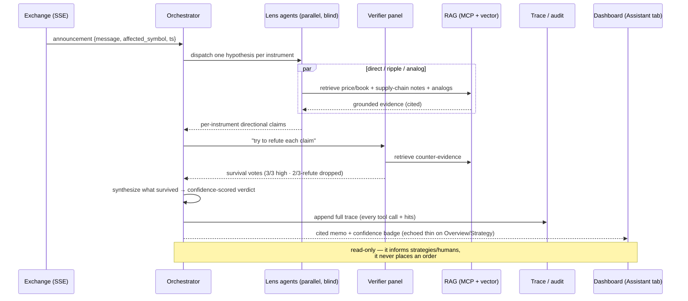

# System Flow — Bots · Backtesting · AI/LLM · Audit → Improvement Loop

How the four pieces fit together end-to-end. Deterministic strategies **trade**; the
AI layer **explains and advises**; the audit trail makes every decision **replayable**;
the replay/backtest loop turns that history into **better parameters** — with a human in
the loop for anything that changes an order or a number.

> Reconciled with `bot-strategy.md` (strategies + cross-cutting layers), `execution-plan.md`
> (phases + AI layer), and the `baseline-bot` source layout.

---

## 1. The whole system at a glance

```mermaid
flowchart LR
    EX["🏦 Exchange (sandbox=dev / live=prod)<br/>SSE /events · REST GET/POST · MCP read tools"]

    %% ---------------- BOT ----------------
    subgraph BOT["🤖 Trading Bot (one process — deterministic, places orders)"]
        direction TB
        FEED["Feed Supervisor (feed.py)<br/>reconnect + Last-Event-ID<br/>isolate handler errors"]
        Q(["Bounded event queue<br/>price · book_update · session · announcement"])
        subgraph ROUTER["Strategy Router — ATR regime gate (runs FIRST)"]
            direction TB
            REG{"ATR% regime<br/>trending / ranging / neutral<br/>per-instrument + hysteresis"}
        end
        subgraph STRATS["BaseStrategy subclasses (per instrument)"]
            direction TB
            S1["NOVA — momentum (wide lookback)"]
            S2["CRVX — momentum (own params)"]
            S3["ELXR — mean-reversion + trend guard"]
            S4["AXON — pairs / lead-lag off NOVA"]
            S5["ELXR/AXON — market-making (inventory-fixed)"]
            S6["DRFT — tiny-size, event-driven"]
        end
        BOOK["Order-book cache<br/>best_bid/ask · spread<br/>(book-aware limit pricing)"]
        SIZE["Dynamic sizing (ATR / liquidity)"]
        OM["OrderManager<br/>pending-exposure tracking<br/>one-active-order/symbol<br/>504 reconciliation"]
        RISK["RiskLimits<br/>500-share cap · stop-loss<br/>rate limiter · anomaly auto-pause"]
        HALT["Halt / kill path<br/>block intents + cancel_all"]
        HB["Heartbeat (~5s: feed age + lifecycle state)"]
    end

    %% ---------------- AI ----------------
    subgraph AI["🧠 AI / LLM Layer (read-only — explains, never trades)"]
        direction TB
        ORCH["Orchestrator (deep agent)<br/>wakes on announcement"]
        LENS["Lens agents (blind to each other)<br/>direct · 1st-ripple · 2nd-ripple · historical-analog"]
        VER["Verifier panel<br/>tries to REFUTE each claim<br/>confidence = survival rate"]
        COMM["Per-trade commentary (single agent, on each fill)"]
        ASST["Conversational assistant (over MCP tools)"]
        RAG[("Hybrid RAG<br/>vector store = narrative<br/>MCP/structured = exact numbers")]
    end

    %% ---------------- AUDIT ----------------
    subgraph AUDIT["🧾 Audit Trail (source of truth)"]
        direction TB
        TRACE["Trace sink<br/>every tool call: owner · args · latency · hits"]
        RUNS[("Run persistence<br/>agent · question · output · trace")]
        TLOG[("Trade log (fixed CSV schema)<br/>+ immutable human-action log")]
    end

    %% ---------------- BACKTEST ----------------
    subgraph BT["🔁 Replay / Backtest & Improve (lightweight, in-scope)"]
        direction TB
        HIST[("Price-history buffers<br/>+ trade log")]
        EVAL["Strategy evaluator<br/>Sharpe · info ratio · fill-rate · win rate"]
        TUNE["Param-tuning proposals<br/>(labelled estimates, confidence band)"]
    end

    %% ---------------- DASHBOARD ----------------
    subgraph DASH["📊 Dashboard (separate process — displays + controls)"]
        direction TB
        D1["Overview · heat map · P&L tiles"]
        D2["Strategy · regime state · 2-step param confirm"]
        D3["Execution · candles+VWAP · fill-rate · lifecycle"]
        D4["Performance · risk-adjusted analytics"]
        D5["Risk & Control · pause/resume · correlation · alerts"]
        D6["Ops · trade log · CSV export · audit log"]
        D7["Assistant · cited answers + confidence"]
        KILL["🔴 GLOBAL kill switch (always visible, no confirm)"]
    end

    %% ---- data plane: exchange -> bot ----
    EX -- "SSE (keyless)" --> FEED
    FEED --> Q
    Q --> REG
    REG -->|selects / stands down| STRATS
    EX -. "book_update / REST snapshot" .-> BOOK
    BOOK --> STRATS
    REG --> SIZE
    BOOK --> SIZE
    SIZE --> STRATS
    STRATS --> OM
    OM --> RISK
    RISK -- "X-API-Key POST limit orders" --> EX
    HALT --> OM

    %% ---- bot -> AI ----
    Q -. "announcement event" .-> ORCH
    OM -. "fill event" .-> COMM
    ORCH --> LENS --> VER --> ORCH
    RAG <--> LENS
    RAG <--> COMM
    ASST -- "read tools" --> EX

    %% ---- everything -> audit ----
    OM --> TLOG
    ORCH --> TRACE
    COMM --> TRACE
    ASST --> TRACE
    TRACE --> RUNS
    DASH -. "human actions" .-> TLOG

    %% ---- audit -> backtest -> improvement ----
    TLOG --> HIST
    FEED -. "price stream" .-> HIST
    HIST --> EVAL --> TUNE
    RUNS --> EVAL

    %% ---- improvement loop (HUMAN-GATED) ----
    TUNE -. "proposal" .-> D2
    D2 == "2-step CONFIRM (human)" ==> ROUTER
    ASST -. "suggestion, never auto-applied" .-> D2

    %% ---- dashboard consumes ----
    EX -- "SSE live data" --> DASH
    HB --> DASH
    KILL == "halt command" ==> HALT
    ORCH -. "cited memo" .-> D7
    COMM -. "why-it-traded" .-> D3
    TLOG --> D6
    EVAL --> D4

    classDef human fill:#ffe8e8,stroke:#d33,stroke-width:2px;
    class KILL,HALT human;
```



---

## 2. How to read it (the four flows)

1. **Data plane (blue path).** Exchange **SSE** → feed supervisor → bounded queue → the
   **ATR regime router runs first** and decides *which* strategy runs (or stands down) per
   instrument → strategy emits an intent → sizing + order-book-aware pricing → **OrderManager**
   (pending exposure, one-active-order/symbol, 504 reconciliation) → **RiskLimits** → limit
   order to the exchange. All money is integer cents; long-only, limit-only.

2. **AI plane (read-only).** An `announcement` event wakes the **orchestrator**, which fans
   out to **blind lens agents** (direct / ripple / analog); a **verifier panel tries to refute**
   each claim and **confidence = how many verifiers a claim survived**. Every fill triggers a
   one-shot **commentary** agent. The **assistant** answers questions over MCP tools. Agents may
   only state numbers that came from a **tool** — narrative from the vector store, exact figures
   from MCP (`source` + `as_of` attached).

3. **Audit trail (source of truth).** The **trace sink** captures every agent/tool call
   (including subagent calls that never appear in the lead's message log); the **trade log**
   (fixed CSV schema + status codes) and the **immutable human-action log** capture everything
   the bot and operators did. This is what makes AI output *auditable by construction*.

4. **Improvement loop (human-gated).** The trade log + price buffers feed a **lightweight
   replay/evaluator** (Sharpe, info ratio, fill-rate) which — together with AI suggestions —
   produces **param-tuning proposals**. Proposals surface on the **Strategy tab as labelled
   estimates** and only reach the router through a **two-step human confirm**. Nothing auto-tunes;
   the kill switch and halt path are the only instant, no-confirm controls.

---

## 3. The announcement engine (the flagship AI flow, in sequence)



---

## 4. Boundaries that keep it safe (say these out loud)

- **Two processes.** Bot and dashboard are separate — if one dies, the other lives.
- **AI never trades.** Deterministic strategies place orders; every agent is read-only.
- **Off the hot path.** AI runs async in seconds — never inside the tick loop.
- **Human owns changes.** Param changes = two-step confirm; emergency halt = one click, no confirm.
- **Numbers are exact + cited.** Figures come from MCP/structured tools, never "remembered."
- **Sandbox = dev, live = prod.** Never tune against a live window.
```
